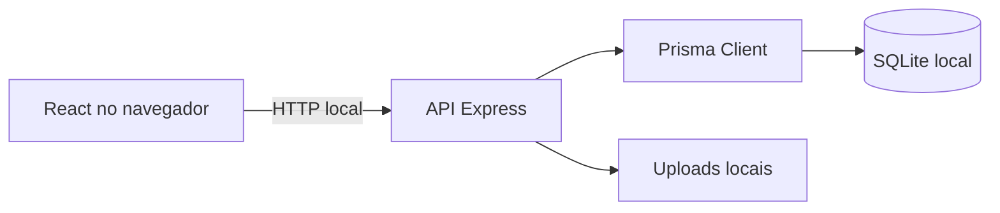

# Gestão de Funcionários

Aplicação local para organizar cadastros de funcionários e rotinas básicas de RH. O projeto reúne interface web, API e banco SQLite no computador do usuário; não tem hospedagem, sincronização em nuvem ou serviço externo configurado.

> Projeto demonstrativo e de uso local. Não substitui folha de pagamento, assessoria jurídica/trabalhista nem sistema de registro de ponto homologado. Não use dados reais sem avaliar a política de privacidade, controle de acesso, retenção e cópias de segurança da sua organização.

## Capturas de tela

Capturas feitas com dados fictícios de demonstração.


## O que o sistema oferece

- Painel com resumo de funcionários, ausências, registros de ponto e pendências.
- Cadastro, busca, edição e desligamento lógico de funcionários, com vínculos opcionais a cargo, departamento e jornada.
- Anexos PDF, JPG e PNG, até 5 MB, guardados na pasta local `backend/uploads/`.
- Cadastro de departamentos, cargos e jornadas.
- Lançamento manual de eventos de ponto e exportação CSV do espelho diário.
- Registro e revisão de férias e ausências, com exportação CSV.
- Contas de acesso com perfis `ADMIN` e `RH`.
- Alteração de senha com revogação das demais sessões.
- Auditoria recente disponível para administradores.
- Banco SQLite, migrações Prisma e comandos locais para backup/restauração.

## Tecnologias

- Interface: React 18, Vite e CSS.
- API: Node.js, Express 4 e JavaScript.
- Persistência: SQLite com Prisma.
- Sessões: JWT com expiração de 8 horas; senhas armazenadas com hash bcrypt.

## Requisitos

- Node.js 20 ou superior e npm.
- Windows, macOS ou Linux.
- Para desenvolver, use um terminal local. A API escuta em `127.0.0.1` e o Vite é configurado para `127.0.0.1`.

## Configuração local

1. Clone ou baixe o repositório e entre na pasta do projeto.
2. Instale as dependências de cada pacote:

   ```bash
   npm ci
   npm ci --prefix backend
   npm ci --prefix frontend
   ```

3. Crie `backend/.env` copiando `backend/.env.example`. Gere um segredo aleatório exclusivo para `JWT_SECRET` (mínimo de 32 caracteres), por exemplo com Node:

   ```bash
   node -e "console.log(require('node:crypto').randomBytes(48).toString('base64url'))"
   ```

   Mantenha o segredo no arquivo local. `.env`, banco, documentos, uploads e builds estão ignorados pelo Git.

4. Prepare o diretório local, gere o cliente Prisma e aplique as migrações:

   ```bash
   npm run db:generate
   npm run db:deploy
   ```

   Para criar ou editar uma migração durante o desenvolvimento do esquema, use `npm run db:migrate`.

5. Crie o primeiro administrador em um terminal interativo. A senha não aparece enquanto é digitada:

   ```bash
   npm run admin:create
   ```

6. Inicie a API e a interface:

   ```bash
   npm run dev
   ```

   Abra `http://127.0.0.1:5173`. A API usa `http://127.0.0.1:5000`. Para servir a interface compilada pela API, execute `npm run build` e depois `npm start`.

## Comandos úteis

| Comando | Descrição |
| --- | --- |
| `npm run dev` | Inicia API e interface para desenvolvimento |
| `npm run build` | Gera a interface de produção em `frontend/dist/` |
| `npm start` | Inicia a API e serve o build, se existir |
| `npm test` | Executa testes de domínio e integração da API |
| `npm run db:generate` | Gera o cliente Prisma |
| `npm run db:deploy` | Aplica migrações existentes |
| `npm run db:migrate` | Cria/aplica migrações no desenvolvimento |
| `npm run admin:create` | Cria o primeiro administrador |
| `npm run format` | Formata os fontes com Prettier |
| `npm run format:check` | Confere o padrão de formatação |
| `npm run backup` | Salva um snapshot do banco e dos anexos |
| `npm run demo:setup` | Cria uma base separada com dados totalmente fictícios |
| `npm run dev:demo` | Inicia a demonstração isolada em localhost |

## Demonstração com dados fictícios

Para preparar uma base segura para capturas de tela ou apresentação, execute:

```bash
npm run demo:setup
npm run dev:demo
```

O primeiro comando cria `backend/data/demo.db`, aplica as migrações, inclui nomes e contatos inventados e mostra uma senha aleatória temporária no terminal. Entre com `demo.admin@local.test` e essa senha em `http://127.0.0.1:5173`. A demonstração nunca utiliza o banco padrão `funcionarios.db`. Para recriá-la, pare os servidores e apague apenas `backend/data/demo.db` antes de executar `npm run demo:setup` novamente.

O repositório contém o código e uma demonstração local; não há versão hospedada para acesso público. Cada pessoa deve gerar a própria base demo e usar a senha temporária que o comando exibe. Não publique senhas, tokens, banco, anexos ou backups.

## Apresentação pública

O repositório pode ser tornado público pelo titular, mas o aplicativo continua local e não terá um link de demonstração online. Para avaliar a interface, use a demo fictícia descrita acima. O projeto não inclui licença de código aberto: todos os direitos permanecem reservados ao titular.

Em telas estreitas, a navegação pode ser percorrida horizontalmente; tabelas largas também permitem rolagem lateral. Os controles de rolagem podem receber foco pelo teclado.

## Backup e restauração

`npm run backup` cria uma pasta datada dentro de `backend/backups/` com snapshot SQLite e documentos. Essa pasta está ignorada pelo Git porque pode conter dados pessoais. Faça cópias apenas para um local protegido.

Para restaurar um backup, pare a aplicação e execute em terminal interativo:

```bash
npm run backup:restore --prefix backend -- backups/PASTA-DO-BACKUP
```

O comando pede confirmação digitada e salva uma cópia de segurança do banco atual antes de substituir os dados. Confira o caminho escolhido com cuidado.

## Estrutura

```text
frontend/src/
  components/           Componentes compartilhados
  constants/            Navegação e constantes
  pages/                Páginas por área do sistema
  services/             Comunicação com a API
  App.jsx                Navegação e layout da aplicação
backend/
  src/app.js             Configuração da API Express
  src/routes/            Rotas de autenticação e RH
  src/middleware/        Autenticação e autorização
  src/prisma/             Cliente e configuração do banco
  prisma/                 Esquema e migrações versionadas
  scripts/                Administração, demo, backup e restauração
  tests/                  Testes unitários e de integração
  data/                   Banco SQLite local (não versionado)
  uploads/                Documentos locais (não versionados)
scripts/                  Preparação de dados fictícios para demo
.github/workflows/        Verificações automatizadas do GitHub Actions
```

## Arquitetura



## Privacidade e segurança

- O app se limita ao computador local; isso não torna o dispositivo automaticamente seguro.
- Banco SQLite e arquivos enviados não são criptografados pela aplicação. Proteja a conta do computador e faça backups locais protegidos.
- A API exige token nas operações de RH; senhas usam bcrypt e tentativas de login têm limite. Usuários desativados perdem acesso às próximas requisições.
- O upload verifica extensão, tipo informado e assinatura básica do arquivo. Isso reduz arquivos incompatíveis, mas não substitui antivírus nem análise de conteúdo.
- O CSV neutraliza fórmulas comuns em células exportadas. O relatório de ponto é uma estimativa baseada nas marcações informadas.
- Não há rotina de recuperação de senha, cálculo de folha/encargos, validação de saldo legal de férias, criptografia em repouso, backup automático ou conformidade/certificação trabalhista.
- Não foi incluído arquivo de licença de código aberto. Todos os direitos permanecem reservados ao titular; autorização é necessária para uso, redistribuição ou revenda.

## Testes e automação

`npm test` executa testes de domínio e integração da API. O GitHub Actions gera o cliente Prisma, roda os testes, confere a formatação e compila a interface em mudanças enviadas ao repositório.

## Contribuição

Este repositório é privado e não aceita contribuições públicas no momento. Sugestões podem ser combinadas diretamente com o titular do projeto.
